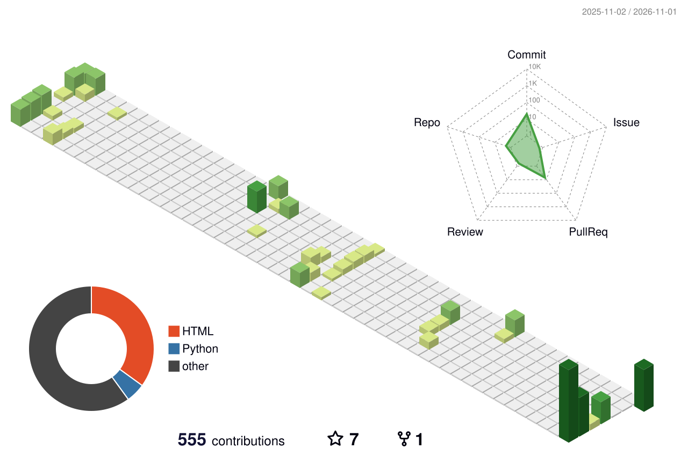

# 💫 About Me:
👋 Hey, I'm Thomas! I'm a Computer Science MSc student at ETH Zurich, focusing on cybersecurity, data systems, and distributed computing. I like to understand how complex systems fit together and make them faster, safer, and easier to use. Lately I've been working with blockchain/DLT infrastructure, eBPF, and AI coding agents.  When I'm not coding, you'll find me playing tennis or beach volleyball, cycling, skiing, or travelling somewhere new 🎾🏐🚴⛷️✈️

## 🌐 Socials:
  

# 💻 Tech Stack:
                      
# 📊 GitHub Stats:

  <picture>
    <source media="(prefers-color-scheme: dark)" srcset="./profile-3d-contrib/profile-night-green.svg" />
    <source media="(prefers-color-scheme: light)" srcset="./profile-3d-contrib/profile-green-animate.svg" />
    
  </picture>

  

---

<!-- Proudly created with GPRM ( https://gprm.itsvg.in ) -->
